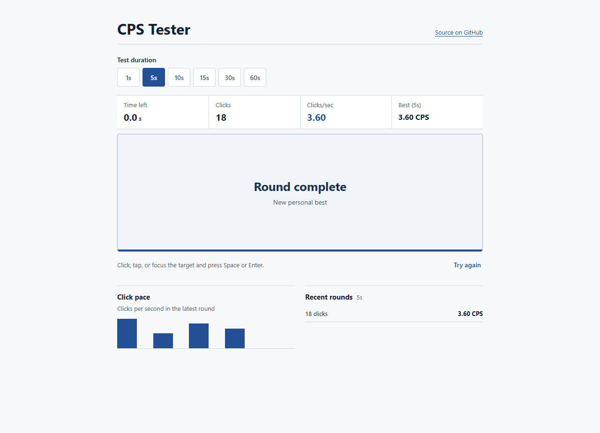

# CPS Tester

Measure your clicks per second in your browser and compare rounds of the same length.

[Open the GitHub Pages demo](https://egalgorix.github.io/Cps-tester/) · [Türkçe özet](#türkçe)



## What it does

- Runs 1, 5, 10, 15, 30, or 60-second tests with a mouse, touch, or keyboard.
- Shows remaining time, click count, clicks per second, and a pace chart.
- Keeps the personal best and six recent rounds for each duration in the current browser.

## Quick start

**Requirements** · Node.js 22 or newer for the local preview and tests. The published site runs directly in the browser.

```sh
npm start
```

Open [http://127.0.0.1:4173/Cps-tester/](http://127.0.0.1:4173/Cps-tester/).

## Usage

Pick a duration and activate the target. The first activation counts and starts the clock. On a keyboard, focus the target and press Space or Enter for each click. When the round ends, select **Try again** to reset it. An active round is canceled if its browser tab is hidden.

## Tests

```sh
npm test
```

## Project status

**Static web app** · GitHub Actions runs the tests before packaging the site for Pages. Scores are stored in the browser and are personal measurements.

## Türkçe

Tıklama hızını fare, dokunmatik ekran veya klavyeyle ölç. İlk tıklama süreyi başlatır ve skora eklenir. Her süre için kişisel rekor ve son altı tur tarayıcıda saklanır.

## License

[CC BY-NC-SA 4.0](https://creativecommons.org/licenses/by-nc-sa/4.0/)

---

Built by [**@egalgorix**](https://github.com/egalgorix)
